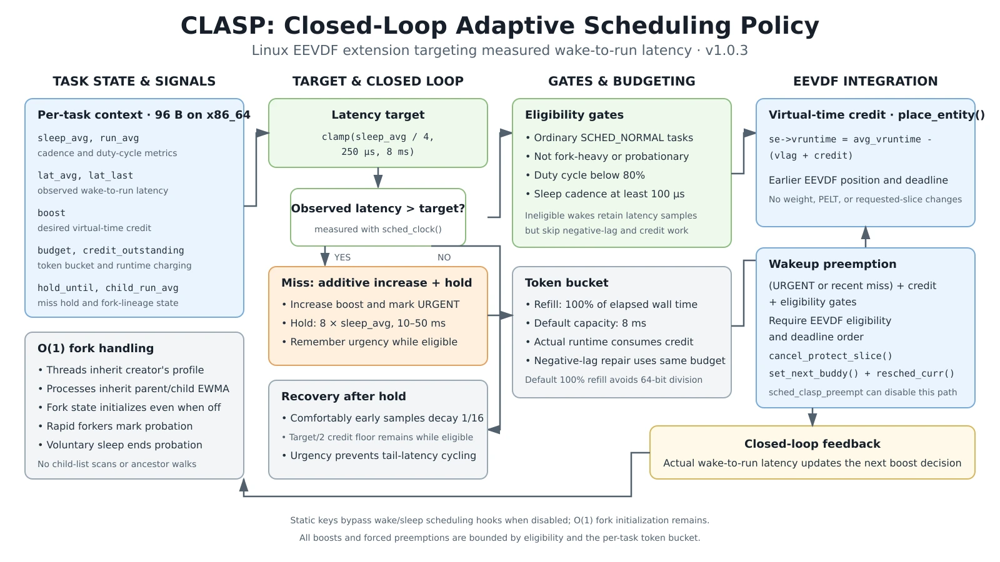

<div align="center">

# CLASP

### Closed-Loop Adaptive Scheduling Policy

**Latency-aware scheduling for Linux EEVDF.**<br>
*Less guessing. More measuring. Better responsiveness under load.*


[Why CLASP?](#why-clasp) ·
[How it works](#how-it-works) ·
[CLASP vs. BORE](#clasp-vs-bore) ·
[Benchmarks](#benchmarks) ·
[Install](#install) ·
[Tunables](#tunables)

</div>

CLASP is a small patch for EEVDF, the Linux kernel's default CPU scheduler, that keeps interactive tasks responsive while the machine is busy.

Instead of guessing which tasks are interactive from how long they run, CLASP asks a simpler question:

> **Did this task actually run on time?**

If it did not, the task gets a small, strictly limited head start the next time it wakes up. Once it is running on time again, the boost eases off.


**About 150× lower tail latency under load.** With 16 CPU hogs competing for the same CPU, 99% of wake-ups ran within **17 µs** with CLASP, against **2.6 ms** on stock Linux 7.3.4, while throughput stayed within a few percent. See [Benchmarks](#benchmarks) for the full numbers.

## Why CLASP?

- 🎯 **Measures instead of guessing** — reacts to the delay a task really experienced, not to assumptions about what kind of task it is.
- 🪙 **Explicitly bounded** — a per-task budget caps how much extra CPU time a boost can cost.
- ⚖️ **Keeps weights as they are** — task weights (nice levels) and the kernel's load tracking are never modified.
- 🚫 **Lightweight** — no per-tick work; CLASP only acts on task events such as wake-up, sleep, and fork.
- 🌱 **Cheap fork handling** — constant-time work at fork, and children of rapid forkers start without a boost.
- ⚡ **Runtime switch** — one `sysctl` turns it off, and the wake/sleep hooks are bypassed while it is off.
- 🧩 **Small and self-contained** — a single patch of about 1,100 lines across seven kernel files, built on EEVDF rather than replacing it.

## How it works



1. **Learn each task's rhythm.** CLASP tracks how long a task usually sleeps between bursts of work and sets its latency target to a quarter of that, kept between 250 µs and 8 ms. A task that wakes every millisecond gets the 250 µs minimum, a 60 Hz task about 4 ms, and a once-a-second daemon the 8 ms maximum.
2. **Measure the real wait.** On every wake-up, CLASP times how long the task waited before it actually got the CPU.
3. **Boost on a miss, and remember it.** A wait longer than the target raises the task's boost and holds it for 10–50 ms, so one bad wake-up is not forgotten before the next one arrives. Once the task is comfortably on time again, the boost decays step by step.
4. **Grant a head start, not a promotion.** A boosted task is placed earlier in the run queue when it wakes, and may preempt the running task when needed. Its weight and time slice stay the same, and a per-task budget (at most 8 ms by default) limits the extra CPU time it can use.

**Guardrails.** Only ordinary (`SCHED_NORMAL`) tasks that sleep regularly qualify. CPU-bound tasks (busy more than 80% of the time), fork-heavy process trees, and tasks that sleep for less than 100 µs at a time get no boost. The stock scheduler already serves that last group well.

## CLASP vs. BORE

| | BORE 7.x | CLASP 1.0.3 |
|---|---|---|
| What it watches | How long a task runs between sleeps (burst time) | How long a task actually waits to run after waking |
| Approach | Open-loop: maps burst time to priority | Closed-loop: measures, corrects, measures again |
| How it helps a task | Persistent change to the task's weight | Bounded, temporary head start |
| Per-tick work | Yes | None |
| Changes weights or load tracking | Yes | No |
| Fork handling | Walks child lists and ancestors | Constant-time |
| Limit on extra CPU time | Implicit in the weight | Explicit per-task budget |
| Main trade-off | More aggressive at low load | Directly targets measured tail latency |

This table compares design, not benchmark results. The measurements below are against upstream Linux.

## Benchmarks

> [!NOTE]
> **Test setup:** Intel i9-14900HX host running CachyOS; QEMU/KVM guest with 8 vCPUs and 4 GiB RAM. The upstream comparison uses two Linux 7.3.4 builds (clang 23.1.5, 1000 Hz tick, full preemption) that differ only in whether CLASP is compiled in. All numbers come from this one host and a second guest VM running on it, so treat them as a reference, not as a guarantee for your workload.

### Wake-up latency under load: CLASP vs. upstream

One task wakes another through a pipe every millisecond while 16 busy-looping threads share the receiver's CPU. Each run lasts 4 seconds (4,000 wake-ups).

| Kernel | p90 median | p99 median | p99 min–max | p999 median | Runs |
|---|---:|---:|---:|---:|---:|
| Upstream EEVDF 7.3.4 | 16.1 µs | 2597.3 µs | 2425.2–2909.6 µs | 2803.6 µs | 9 |
| **CLASP 1.0.1** | **10.2 µs** | **17.4 µs** | **16.4–17.8 µs** | **29.9 µs** | **8** |

p99 is the delay that 99% of wake-ups stay under; p999 covers 99.9%. Upstream is quick most of the time, but at least one wake-up in a hundred waits a full time slice of about 2.6 ms. CLASP removes that tail: its worst run measured 17.8 µs at p99 and 45.8 µs at p999.

These matched runs were recorded with CLASP 1.0.1. Version 1.0.3 keeps the same latency behavior with lower overhead, and was re-checked with the on/off tests further down.

### Throughput: CLASP vs. upstream

Pipe results are millions of messages/s with 1, 4, and 8 pairs; CPU is billions of operations/s; fork is forks/s. Higher is better.

| Kernel | Pipe 1 | Pipe 4 | Pipe 8 | CPU | Fork |
|---|---:|---:|---:|---:|---:|
| Upstream EEVDF 7.3.4 | 1.767 | 5.980 | 10.663 | 5.456 | 705 |
| **CLASP 1.0.1** (off-phase first) | **1.777** | **5.742** | **10.342** | **5.532** | **705** |
| **CLASP 1.0.1** (on-phase first) | **1.741** | **5.828** | **10.279** | **5.606** | **705** |

The two CLASP rows are separate boots with the on/off test order reversed. Against upstream, pipe throughput ranged from −4.0% to +0.6%, CPU throughput from +1.4% to +2.8%, and fork throughput was unchanged. These are single runs, so read them as "no large cost" rather than as a throughput win.

### On a live system: CLASP on vs. off

The CLASP kernel was also loaded into a running 21-vCPU Linux guest with a real root filesystem and systemd, then tested under 16 hogs with CLASP switched on and off.

| Version | Probe | CLASP on | CLASP off |
|---|---|---:|---:|
| 1.0.3 | IPC p99 | 9.1–21.1 µs | 2520–2650 µs |
| 1.0.3 | IPC p999 | 29.4–33.4 µs | 3620–7110 µs |
| 1.0.1 | IPC p99 | 23.4–24.1 µs | 2585.9–2732.6 µs |
| 1.0.1 | Timer p99 | 55.9 µs | 2771.2 µs |
| 1.0.1 | Pipe 8 | 9.329 M msgs/s | 9.031 M msgs/s |
| 1.0.1 | CPU | 5.653 G ops/s | 5.620 G ops/s |
| 1.0.1 | Fork | 691 forks/s | 696 forks/s |

The 1.0.3 rows are the range over three passes. This is an on/off check on a live system, not a matched upstream comparison.

### Real workloads: CLASP 1.0.3 on vs. off

Measured in the same live guest. Each workload was warmed up once, then run in off/on pairs with the order alternating. Changes are wall-clock time unless noted, so negative means faster with CLASP.

| Workload | Pairs | Change with CLASP on |
|---|---:|---|
| 22-file C build, `make -j4` | 4 | **+0.4%** wall, +0.1% user, **−15%** sys |
| `tar + gzip` over `/usr/share/doc` | 2 | **−1.8%** |
| fork+exec `/bin/true`, 3000 iterations | 3 | **−3.0%** |
| 40× `find /usr/include` | 8 | **+1.0%**, identical context-switch count |
| 20× `grep`/`tar` over `/usr/include` | 4 | within run noise |
| IPC probe while `make -j4` runs on other vCPUs | 6 pairs × 4 s | p99 **15.8–19.1 µs**, p999 **25–40 µs** vs p99 **2.04–3.52 ms**, p999 **2.80–6.10 ms** off |

Build and file workloads show no systematic throughput cost, while p99 and p999 wake-up latency stay in the tens of microseconds during a parallel build.

## Install

CLASP ships as a single patch for a pristine Linux source tree. The reference target is **upstream Linux 7.3.4**.

```sh
cd linux-7.3.4
patch -p1 < /path/to/patches/stable/0001-linux7.3.4-clasp-1.0.3.patch

make olddefconfig        # CONFIG_SCHED_CLASP defaults to y
make -j"$(nproc)"
```

No boot parameter is needed; CLASP is enabled by default. You can switch it off and on at runtime, without a reboot:

```sh
sysctl -w kernel.sched_clasp=0   # off
sysctl -w kernel.sched_clasp=1   # on
```

**On a newer kernel?** Run `python3 distrib/run.py`. It fetches the latest stable release from kernel.org, rebases CLASP onto it, validates the result (clean apply, scheduler compile, and a quick QEMU/KVM boot test when KVM is available), and saves a ready-to-use patch under `patches/stable/`. See [`distrib/README.md`](distrib/README.md) for details.

> [!NOTE]
> For CachyOS or other patched kernels, apply CLASP to the matching upstream source first, then port the small `kernel/sched/fair.c` changes.

## Tunables

All controls live under `/proc/sys/kernel/` and can be changed at runtime. The published benchmarks use the defaults.

| Sysctl | Default | Range | Purpose |
|---|---:|---:|---|
| `sched_clasp` | 1 | 0–1 | Master on/off switch |
| `sched_clasp_preempt` | 1 | 0–1 | Let a task that missed its target preempt the running task |
| `sched_clasp_target_min_us` | 250 | 0–1000000 | Tightest latency target (µs) |
| `sched_clasp_target_max_us` | 8000 | 0–1000000 | Loosest latency target (µs) |
| `sched_clasp_target_shift` | 2 | 0–8 | Target = average sleep ÷ 2^shift (default: a quarter) |
| `sched_clasp_boost_max_us` | 4000 | 0–1000000 | Largest boost per wake-up (µs) |
| `sched_clasp_budget_pct` | 100 | 0–100 | Budget refill rate, as a percentage of elapsed time |
| `sched_clasp_budget_cap_us` | 8000 | 0–1000000 | Largest budget a task can save up (µs) |
| `sched_clasp_duty_pct` | 80 | 0–100 | Tasks busier than this percentage of the time get no boost |
| `sched_clasp_min_sleep_us` | 100 | 0–1000000 | Tasks sleeping less than this get no boost (µs) |
| `sched_clasp_fork_penalty_us` | 4000 | 0–1000000 | Minimum starting run-time estimate for children of rapid forkers (µs) |

Per-CPU statistics are available in `/sys/kernel/debug/sched_clasp`.

## Run the benchmarks yourself

The repository includes a self-contained benchmark that boots any kernel image in QEMU/KVM (8 vCPUs, 4 GiB RAM). No root filesystem or modules are needed.

```sh
tests/run-vm.sh arch/x86/boot/bzImage clasp
tests/run-vm.sh /boot/vmlinuz-linux-cachyos cachyos-default
```

It measures wake-up latency plus pipe, CPU, and fork throughput, and automatically runs CLASP on/off, BORE on/off, or a single baseline phase depending on what the kernel supports. Results are written to `.build/results/<tag>.log`. See [`tests/README.md`](tests/README.md) for the available test modes and how to read the results.

## Status

CLASP 1.0.3 is the current stable release. It is still a young project, and these areas have not been validated yet:

- **More machines** — all results so far come from one host, and worst-case (maximum) latency has not yet been separated from host and start-up noise.
- **CPU topology** — SMT siblings and shared-cache effects are not specially handled yet.
- **Fairness setups** — cgroup CPU limits and autogroup are untested.
- **Mixed workloads** — gaming, audio, real-time tasks, and `sched_ext` still need validation.
- **Multi-tenant use** — tasks can earn a bounded amount of extra CPU time through their sleep pattern, which needs a security review.

The patch is small but tied to scheduler internals, so it needs re-validation on each new kernel version. Try CLASP on your own workload before relying on it in production.

## Credits

CLASP builds on the upstream Linux scheduler and the EEVDF design. It was developed as an alternative to burst-time heuristics such as BORE. The benchmark harness is self-contained and does not include BORE code.

## License

**GPL-2.0** — see [`LICENSE.txt`](LICENSE.txt).
