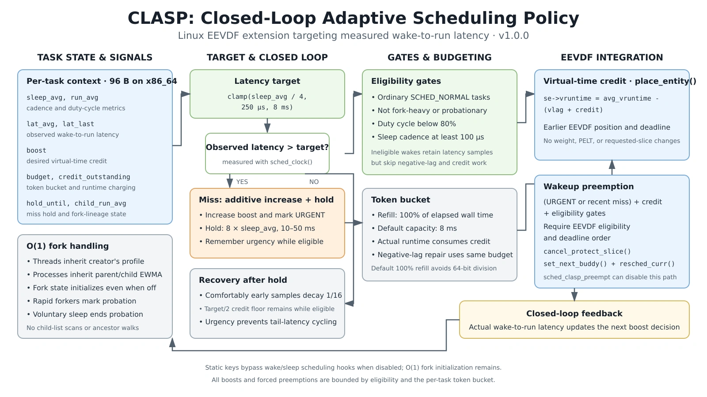
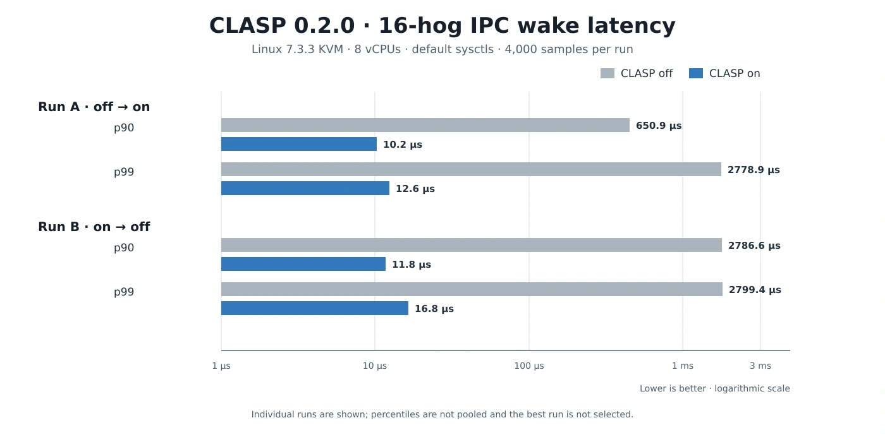

<div align="center">

# CLASP

### Closed-Loop Adaptive Scheduling Policy

**Latency-aware scheduling for Linux EEVDF.**  
*Less guessing. More measuring. Better responsiveness under load.*


[Why CLASP?](#why-clasp) ·
[How it works](#how-it-works) ·
[Results](#initial-results) ·
[Install](#build-and-install) ·
[Tune](#tunables) ·
[Test](#test-harness)

</div>

CLASP is an experimental Linux EEVDF extension that targets **measured wake-to-run latency**.

Instead of guessing whether a task is interactive from burst-time heuristics, CLASP asks a simpler question:

> **Did this task actually run on time?**

If not, CLASP grants a bounded amount of virtual-time credit, moving the task earlier in EEVDF scheduling order. As latency recovers, boost decays above a bounded credit floor.

> [!WARNING]
> CLASP's reference integration targets **upstream Linux**. The
> `distrib/run.py` tool rebases it to the latest stable kernel. It is not yet
> production-ready. Current results come from a single-VM KVM benchmark suite.

## Why CLASP?

- 🎯 **Closed-loop control** - reacts to observed latency, not assumed task behavior.
- 🚫 **No per-tick accounting** - keeps the scheduler hot path lightweight.
- ⚖️ **No weight or PELT changes** — leaves `se->load.weight`, PELT averages, and hierarchical load untouched.
- 🪙 **Explicitly bounded boost** - a per-task token bucket limits extra CPU time.
- 🌱 **O(1) fork handling** - no child-list scans or ancestor walks.
- ⚡ **Static-key bypass when disabled** — wake/sleep hooks are skipped; O(1) fork initialization remains.

### Headline result

With **16 CPU hogs** competing with the probe, two same-kernel CLASP 0.2.0 A/B runs reduced IPC wakeup p99 from **2778.9 µs to 12.6 µs** and **2799.4 µs to 16.8 µs**. The phase order was reversed for the second run.

| Run | Off p90 | Off p99 | On p90 | On p99 |
|---|---:|---:|---:|---:|
| A: off → on | 650.9 µs | 2778.9 µs | **10.2 µs** | **12.6 µs** |
| B: on → off | 2786.6 µs | 2799.4 µs | **11.8 µs** | **16.8 µs** |

A separate CachyOS 7.3.1 run measured 1584.6 µs p90 and 1600.3 µs p99. These are preliminary single-host measurements; see [Initial results](#initial-results) for throughput, outliers, and caveats.

## How it works



```text
Sleep cadence ──► Latency target
                       │
Wake-to-run sample ────┼──► Target missed?
                       │          │
                       │          ├─ No ──► Hold, then decay above floor
                       │          │
                       │          └─ Yes ─► Increase boost + mark URGENT
                       │                     │
                       │                     ▼
                       │          Bounded virtual-time credit
                       │                     │
                       │                     ▼
                       │          Earlier EEVDF position/deadline
                       │                     │
                       └────────────► Eligible preemption when needed
```

### 1. Learn the task’s cadence

Each task keeps a **96-byte context on x86_64** containing run, sleep, latency, boost, budget, and fork-lineage state.

Its latency target comes from voluntary sleep duration:

```text
target = clamp(sleep_avg / 4, 250 µs, 8 ms)
```

Examples:

- A task waking every **1 ms** receives the **250 µs** minimum target.
- A **60 Hz** task receives a target of approximately **4 ms**.
- A once-per-second daemon receives the **8 ms** cap.

The sleep average adapts downward immediately and upward slowly, allowing tasks to change cadence without retaining an overly relaxed target.

### 2. Measure the real delay

Latency is measured with `sched_clock()`, from wakeup to actual execution.

`rq_clock` is deliberately avoided: scheduler-clock quantization can report sub-tick wakeups as zero, hiding exactly the delays CLASP needs to observe.

### 3. Respond to misses—and remember them

When observed latency exceeds the target:

- the task becomes `URGENT`;
- its boost increases additively;
- a hold window of `8 × sleep_avg`, clamped to **10–50 ms**, begins.

During the hold window, on-time samples do not reduce the boost. This prevents one tail-latency miss from being forgotten before the next one arrives. Afterward, comfortably early samples decay the boost by **1/16**, subject to a `target / 2` credit floor while the task remains eligible.

Urgency is remembered rather than cleared on the first on-time sample. This is intentional: a recent-miss-only variant allowed the one-slice tail to return in KVM testing. An urgent task can force preemption only while it has credit, passes the eligibility gates, and satisfies EEVDF’s eligibility and deadline checks.

### 4. Grant credit, not permanent priority

Credit is applied as negative lag in `place_entity()`:

```c
se->vruntime = avg_vruntime - (vlag + credit_vruntime);
```

This moves the waking task—and its virtual deadline—earlier without changing its requested slice or task weight.

A per-task token bucket bounds the grant:

- default refill: **100% of elapsed wall time**, using a division-free fast path;
- other refill percentages retain integer division;
- default capacity: **8 ms**;
- outstanding credit is consumed by actual runtime;
- negative-lag repair is charged to the same budget.

### Built-in guardrails

Credit is limited to ordinary `SCHED_NORMAL` tasks that:

- are not from fork-heavy or probationary lineage;
- have a duty cycle below **80%**;
- sleep for at least **100 µs** per cadence.

The cadence gate avoids forcing preemption for sub-100 µs IPC ping-pong, where normal EEVDF wakeup preemption already works and extra intervention adds overhead. Ineligible wakes still update cadence, budget, and latency samples, but skip negative-lag conversion and credit-grant work.

Fork handling is entirely O(1): threads inherit the creating thread's latency profile, processes inherit compact parent/child EWMA state, and rapid forkers produce probationary children. A voluntary sleep ends probation and clears the fork-heavy mark. Fork state is initialized even while scheduling hooks are disabled, preventing children from inheriting stale timestamps or duplicated budget.

## CLASP vs. BORE

| | BORE 7.x | CLASP 0.2.0 |
|---|---|---|
| Primary signal | Burst time since sleep/yield | Actual wake-to-run latency |
| Control model | Open-loop burst mapping | Closed-loop AIMD with hold |
| Priority lever | Persistent task-weight changes | Bounded virtual-time credit |
| Per-tick work | `update_curr` hook | None |
| Weight/PELT changes | Yes | No |
| Fork handling | Child lists and ancestor walks | O(1) EWMA and fork-rate marking |
| Extra CPU bound | Implicit in weight | Explicit token bucket |
| Main trade-off | More aggressive at low load | Directly targets measured tail latency |

## Build and install

CLASP is distributed as a standard patch for a pristine **Linux Kernel** tree.

Example for the Linux 7.3.3 patch:

```sh
cd linux-7.3.3

patch -p1 < /path/to/patches/stable/0001-linux7.3.3-clasp-0.2.0.patch

make olddefconfig        # CONFIG_SCHED_CLASP defaults to y
grep CONFIG_SCHED_CLASP .config
make -j"$(nproc)"
```

No kernel command-line parameter is required. CLASP boots enabled by default.

### Latest-kernel automation

```sh
python3 distrib/run.py
```

With no arguments, the distribution tool:

1. finds the latest stable Linux release on kernel.org;
2. downloads and checksum-verifies the source;
3. rebases the newest CLASP patch onto it;
4. regenerates a clean versioned patch;
5. validates the result with an apply check, scheduler compile, and a
   QEMU/KVM quick smoke boot when KVM is available;
6. installs the validated patch as
   `patches/stable/0001-linux<version>-clasp-<version>.patch`.

See [`distrib/README.md`](distrib/README.md) for details, options, and the
cache/work-directory layout.

To disable or re-enable it at runtime:

```sh
sysctl -w kernel.sched_clasp=0
sysctl -w kernel.sched_clasp=1
```

Disabling CLASP preserves existing task state but stops new credit and forced-preemption decisions.

> [!NOTE]
> For CachyOS or other patched kernels, apply CLASP to the matching upstream source first, then port the small `fair.c` hunks. The surrounding EEVDF code is the main source of patch offsets.

<details>
<summary>Files touched by the patch</summary>

```text
include/linux/sched.h
include/linux/sched/clasp.h     (new)
init/Kconfig
kernel/sched/Makefile
kernel/sched/clasp.c            (new)
kernel/sched/core.c
kernel/sched/fair.c
```

</details>

## Tunables

All controls live under `/proc/sys/kernel/`.

| Sysctl | Default | Range | Purpose |
|---|---:|---:|---|
| `sched_clasp` | 1 | 0–1 | Master enable |
| `sched_clasp_preempt` | 1 | 0–1 | Allow measured-miss forced preemption |
| `sched_clasp_target_min_us` | 250 | 0–1000000 | Minimum latency target |
| `sched_clasp_target_max_us` | 8000 | 0–1000000 | Maximum latency target |
| `sched_clasp_target_shift` | 2 | 0–8 | `target = sleep_avg >> shift` |
| `sched_clasp_boost_max_us` | 4000 | 0–1000000 | Maximum desired credit per wake |
| `sched_clasp_budget_pct` | 100 | 0–100 | Token refill as a percentage of elapsed time |
| `sched_clasp_budget_cap_us` | 8000 | 0–1000000 | Token-bucket capacity |
| `sched_clasp_duty_pct` | 80 | 0–100 | Maximum eligible duty cycle |
| `sched_clasp_min_sleep_us` | 100 | 0–1000000 | Minimum eligible sleep cadence |
| `sched_clasp_fork_penalty_us` | 4000 | 0–1000000 | Initial run floor for fork-heavy children |

Debug counters are available through:

```sh
cat /sys/kernel/debug/sched_clasp
```

```text
cpu wakeups boosted misses credit_ns lat_sum_ns lat_max_ns boost_sum_ns preempt_try preempt_ok ineligible
```

`preempt_try` counts requested forced preemptions, `preempt_ok` counts those passing EEVDF eligibility, and `ineligible` counts wakes with negative EEVDF `vlag`.

## Test harness

The self-contained harness builds a tiny static initramfs and boots QEMU/KVM with **8 vCPUs and 4 GiB RAM**—no root filesystem or modules required.

```sh
tests/run-vm.sh /boot/vmlinuz-linux-cachyos cachyos-default
tests/run-vm.sh arch/x86/boot/bzImage clasp
```

Results are written to:

```text
.build/results/<tag>.log
```

The harness automatically runs CLASP on/off, BORE on/off, or baseline phases depending on available sysctls. Add `clasp.reverse=1` to the kernel command line for a second run with the CLASP phases reversed.

For a short smoke test, use `clasp.quick=1`; this deliberately applies more aggressive tunables and is not a default-configuration benchmark. For a shorter default-tunables tuning run, use `clasp.tune=1` to test 16-hog IPC and eight-pair pipe off/on.

Measurements cover IPC and timer wake latency, pipe throughput, CPU throughput, fork throughput, and fork-storm latency. Runs require a completion marker and reject benchmark or control-write errors. See [`tests/README.md`](tests/README.md) for interpretation and caveats.

## Harness validation

The original harness had two material reporting defects: p999 used a percent rather than per-mille index and therefore returned the maximum, and the compiler removed the unused CPU workload. The old p999 values and CPU-throughput percentages are not valid performance evidence. The corrected harness preserves the CPU computation, calculates p999 separately from max, checks affinity and control writes, uses atomic IPC timestamps, and supports reversed A/B phase order.

The earlier single-run CachyOS and BORE comparisons were not reproduced on those same kernel builds and are not used as evidence below. Same-kernel CLASP off/on results are the primary comparison.

Aggressive quick mode is a functional smoke test, not performance evidence: one clean 0.2.0 smoke returned 2798.8 µs IPC p99 and a follow-up recheck returned 16.8 µs. The full default-configuration A/B runs below are the performance baseline.

## Initial results

**Environment:** CachyOS host with an Intel CPU, QEMU/KVM with 8 vCPUs and 4 GiB guest RAM, upstream Linux 7.3.3 with the distribution defconfig options, `HZ=1000`, `PREEMPT_DYNAMIC=y` with full preemption, clang/LLD 23.1.4, and `CONFIG_LTO_NONE=y`. QEMU was pinned to host CPUs `0,2,4,...,14`; the separate libvirt guest was left running and was not used for measurements.

Each latency result is one 4-second run with 4,000 samples at a 1 ms IPC cadence. CLASP 0.2.0 was tested twice: control-then-enabled and enabled-then-control. Both runs are reported rather than pooling percentiles or selecting the best run.

### IPC wakeup latency under 16 hogs



| Kernel / phase | p50 | p90 | p99 | p999 | Mean |
|---|---:|---:|---:|---:|---:|
| A: CLASP off | 9.4 µs | 650.9 µs | 2778.9 µs | 2799.5 µs | 232.1 µs |
| **A: CLASP on** | **7.3 µs** | **10.2 µs** | **12.6 µs** | **22.9 µs** | **13.7 µs** |
| **B: CLASP on** | **9.8 µs** | **11.8 µs** | **16.8 µs** | **27.6 µs** | **10.2 µs** |
| B: CLASP off | 6.8 µs | 2786.6 µs | 2799.4 µs | 2806.6 µs | 900.2 µs |
| CachyOS 7.3.1 baseline | 10.2 µs | 1584.6 µs | 1600.3 µs | 1608.0 µs | 428.5 µs |

The consistent change is the **tail**: enabled p99 is 12.6–16.8 µs, versus approximately 2.8 ms with CLASP off. The separate CachyOS result is an external reference, not an identical-config comparison.

> [!IMPORTANT]
> Maximum-latency outliers remain: 20.9 ms in run A and 1.38 ms in run B. Their host-versus-guest causes were not isolated, so they are not claimed as scheduler improvements or regressions.

A recent-miss-only preemption experiment was rejected. It retained a 12.2 µs p90 but allowed p99 to return to 2776.6 µs. This result is why 0.2.0 keeps sticky urgency while the task remains eligible.

### Relative throughput cost

Each cell compares CLASP on against its own off phase in that run. Negative values mean lower throughput.

| Version / run | Pipe 1 | Pipe 4 | Pipe 8 | CPU | Fork |
|---|---:|---:|---:|---:|---:|
| 0.1.0 A | −8.1% | −3.6% | −8.2% | −0.3% | 0% |
| 0.1.0 B | −6.2% | −5.4% | −6.1% | −0.0% | 0% |
| **0.2.0 A** | **−16.6%** | **−8.6%** | **−9.6%** | **−1.6%** | **0%** |
| **0.2.0 B** | **−6.5%** | **−8.0%** | **−2.2%** | **+1.8%** | **−0.1%** |

The division-free refill and ineligible-wake early return reduce arithmetic without changing policy, but these measurements do **not** establish a throughput improvement. Pipe overhead remains and varies substantially with phase order. The pipe test also includes shared atomic-counter contention, and fork rates are rounded to integer forks/s. More repeated, less contended throughput tests are needed before making a performance claim.

## Before production use

CLASP is promising, but still needs broader validation:

- **More benchmarking:** repeated runs, more machines, and identical-config A/B builds.
- **Outlier analysis:** separate host steal from guest scheduling with tracing and `perf sched`.
- **Topology:** wake CPU selection, SMT siblings, and LLC contention are not yet adapted.
- **Fairness:** test cgroups, bandwidth limits, and autogroup behavior.
- **Mixed workloads:** validate RT/DL, `sched_ext`, gaming, audio, and input-to-photon behavior.
- **Portability:** EEVDF integration hunks are small but kernel-version-sensitive.
- **Security:** tasks can earn bounded extra CPU through sleep/miss behavior; multi-tenant risk needs review.

## Credits

CLASP builds on the upstream Linux scheduler and EEVDF design. It was developed as an alternative to burst-time heuristics such as BORE.

The benchmark harness is self-contained and does not include BORE code.

## License

**GPL-2.0** — see [`LICENSE.txt`](LICENSE.txt).
