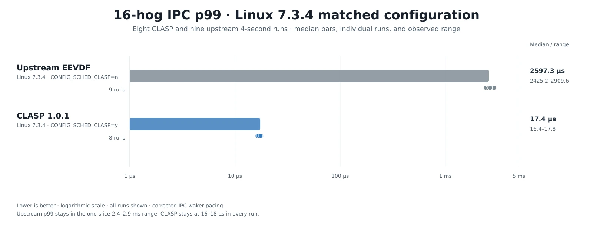

<div align="center">

# CLASP

### Closed-Loop Adaptive Scheduling Policy

**Latency-aware scheduling for Linux EEVDF.**  
*Less guessing. More measuring. Better responsiveness under load.*


[Why CLASP?](#why-clasp) ·
[How it works](#how-it-works) ·
[Results](#scheduler-comparison) ·
[Install](#build-and-install) ·
[Tune](#tunables) ·
[Test](#test-harness)

</div>

CLASP 1.0.3 is a performance release of this Linux EEVDF latency controller, targeting **measured wake-to-run latency** with lower scheduling overhead. It retains the 1.0.1 delayed-dequeue fix, applies bounded credit directly when an unchanged delayed placement is safe to reuse, avoids re-placement for ineligible wakes, keeps sub-threshold sleepers on a lightweight accounting path, and adds focused throughput, real-time-floor, and cadence-transition validation.

Instead of guessing whether a task is interactive from burst-time heuristics, CLASP asks a simpler question:

> **Did this task actually run on time?**

If not, CLASP grants a bounded amount of virtual-time credit, moving the task earlier in EEVDF scheduling order. As latency recovers, boost decays above a bounded credit floor.

> [!WARNING]
> CLASP's reference integration targets **upstream Linux 7.3.4**, and
> `distrib/run.py` rebases it to newer stable kernels. The 1.0.3 designation is
> a performance release, not a guarantee for every production workload. Current
> performance results come from one KVM host and one additional libvirt guest.
> The 1.0.1 delayed-dequeue wake fix is retained; see
> [Harness validation](#harness-validation).

## Why CLASP?

- 🎯 **Closed-loop control** - reacts to observed latency, not assumed task behavior.
- 🔁 **Delayed-dequeue aware** - wakes that EEVDF kept on the runqueue are measured; safe credit deltas avoid full EEVDF re-placement.
- 🚫 **No per-tick accounting** - keeps the scheduler hot path lightweight.
- ⚖️ **No weight or PELT changes** — leaves `se->load.weight`, PELT averages, and hierarchical load untouched.
- 🪙 **Explicitly bounded boost** - a per-task token bucket limits extra CPU time.
- 🌱 **O(1) fork handling** - no child-list scans or ancestor walks.
- ⚡ **Static-key bypass when disabled** — wake/sleep hooks are skipped; O(1) fork initialization remains.

### Headline result

Across eight CLASP 1.0.1 runs with **16 CPU hogs** and corrected IPC waker pacing, p99 was **16.4–17.8 µs** (median **17.4 µs**) and p999 was **24.8–45.8 µs**. A matched upstream 7.3.4 build stayed at p99 **2.43–2.91 ms** in all nine runs. The 1.0.0 one-slice tail is no longer reproduced.

| CLASP 1.0.1 IPC p99 | Best | Median | Worst |
|---|---:|---:|---:|
| Eight independent runs | **16.4 µs** | **17.4 µs** | **17.8 µs** |

CLASP 1.0.3 retains that tail behavior while reducing wake accounting. In the running-guest spot check, IPC p99 was **9.1–21.1 µs** and p999 **29.4–33.4 µs** under 16 hogs, against **2.52–2.65 ms** and **3.62–7.11 ms** with CLASP off; see [1.0.3 running-guest spot check](#103-running-guest-spot-check).

See [Scheduler comparison](#scheduler-comparison) for the matched upstream results, throughput, the real-guest check, and validation limits.

## How it works


```text
Sleep cadence ──► Latency target
                       │
Wake-to-run sample ────┼──► Target missed?
                       │          │
                       │          ├─ No ──► Hold, then decay above floor
                       │          │
                       │          └─ Yes ─► Increase boost + mark URGENT
                       │                     │
                       │                     ▼
                       │          Bounded virtual-time credit
                       │                     │
                       │                     ▼
                       │          Earlier EEVDF position/deadline
                       │                     │
                       └────────────► Eligible preemption when needed
```

### 1. Learn the task’s cadence

Each task keeps a **96-byte context on x86_64** containing run, sleep, latency, boost, budget, and fork-lineage state.

Its latency target comes from voluntary sleep duration:

```text
target = clamp(sleep_avg / 4, 250 µs, 8 ms)
```

Examples:

- A task waking every **1 ms** receives the **250 µs** minimum target.
- A **60 Hz** task receives a target of approximately **4 ms**.
- A once-per-second daemon receives the **8 ms** cap.

The sleep average adapts downward immediately and upward slowly, allowing tasks to change cadence without retaining an overly relaxed target.

### 2. Measure the real delay

Latency is measured with `sched_clock()`, from wakeup to actual execution.

`rq_clock` is deliberately avoided: scheduler-clock quantization can report sub-tick wakeups as zero, hiding exactly the delays CLASP needs to observe.

**Delayed-dequeue wake coverage.** A wake does not always pass through `place_entity()`. If EEVDF kept the sleeping entity on the runqueue (delayed dequeue), `requeue_delayed_entity()` may requeue it without a placement when its lag did not change. When that unchanged placement is safe to reuse, 1.0.3 applies the bounded credit delta directly, recomputes the deadline, and reorders the entity without repeating the full placement calculation. Current entities, relative deadlines, and heavy-entity cases retain the full path; ineligible wakes use lightweight cadence and wake-time accounting. This preserves the 1.0.1 fix while reducing both short-IPC and eligible-wake overhead. A sleep below the cadence gate takes an even lighter path: it updates cadence only, defers token-bucket refill and latency sampling to the first wake that can pass the gate, and reuses the wake timestamp as a conservative sleep-start estimate. The estimate can only overstate sleep duration, so the fast path is taken only when the real sleep was definitely below the gate; an overestimate simply falls back to the full path.

### 3. Respond to misses—and remember them

When observed latency exceeds the target:

- the task becomes `URGENT`;
- its boost increases additively;
- a hold window of `8 × sleep_avg`, clamped to **10–50 ms**, begins.

During the hold window, on-time samples do not reduce the boost. This prevents one tail-latency miss from being forgotten before the next one arrives. Afterward, comfortably early samples decay the boost by **1/16**, subject to a `target / 2` credit floor while the task remains eligible.

Urgency is remembered rather than cleared on the first on-time sample. This is intentional: a recent-miss-only variant allowed the one-slice tail to return in KVM testing. An urgent task can force preemption only while it has credit, passes the eligibility gates, and satisfies EEVDF’s eligibility and deadline checks.

### 4. Grant credit, not permanent priority

Credit is applied as negative lag in `place_entity()`:

```c
se->vruntime = avg_vruntime - (vlag + credit_vruntime);
```

This moves the waking task—and its virtual deadline—earlier without changing its requested slice or task weight.

A per-task token bucket bounds the grant:

- default refill: **100% of elapsed wall time**, using a division-free fast path;
- other refill percentages retain integer division;
- default capacity: **8 ms**;
- outstanding credit is consumed by actual runtime;
- negative-lag repair is charged to the same budget.

### Built-in guardrails

Credit is limited to ordinary `SCHED_NORMAL` tasks that:

- are not from fork-heavy or probationary lineage;
- have a duty cycle below **80%**;
- sleep for at least **100 µs** per cadence.

The cadence gate avoids forcing preemption for sub-100 µs IPC ping-pong, where normal EEVDF wakeup preemption already works and extra intervention adds overhead. Ineligible wakes still update their sleep cadence; sub-threshold sleeps defer budget refill and latency sampling until a wake can pass the gate, and skip negative-lag conversion and credit-grant work.

Fork handling is entirely O(1): threads inherit the creating thread's latency profile, processes inherit compact parent/child EWMA state, and rapid forkers produce probationary children. A voluntary sleep ends probation and clears the fork-heavy mark. Fork state is initialized even while scheduling hooks are disabled, preventing children from inheriting stale timestamps or duplicated budget.

## CLASP vs. BORE

| | BORE 7.x | CLASP 1.0.3 |
|---|---|---|
| Primary signal | Burst time since sleep/yield | Actual wake-to-run latency |
| Control model | Open-loop burst mapping | Closed-loop AIMD with hold |
| Priority lever | Persistent task-weight changes | Bounded virtual-time credit |
| Per-tick work | `update_curr` hook | None |
| Weight/PELT changes | Yes | No |
| Fork handling | Child lists and ancestor walks | O(1) EWMA and fork-rate marking |
| Extra CPU bound | Implicit in weight | Explicit token bucket |
| Main trade-off | More aggressive at low load | Directly targets measured tail latency |

## Build and install

CLASP is distributed as a standard patch for a pristine **Linux Kernel** tree.

Example for the Linux 7.3.4 patch:

```sh
cd linux-7.3.4

patch -p1 < /path/to/patches/stable/0001-linux7.3.4-clasp-1.0.3.patch

make olddefconfig        # CONFIG_SCHED_CLASP defaults to y
grep CONFIG_SCHED_CLASP .config
make -j"$(nproc)"
```

No kernel command-line parameter is required. CLASP boots enabled by default.

### Latest-kernel automation

```sh
python3 distrib/run.py
```

With no arguments, the distribution tool:

1. finds the latest stable Linux release on kernel.org;
2. downloads and checksum-verifies the source;
3. rebases the newest CLASP patch onto it;
4. regenerates a clean versioned patch;
5. validates the result with an apply check, scheduler compile, and a
   QEMU/KVM quick smoke boot when KVM is available;
6. installs the validated patch as
   `patches/stable/0001-linux<version>-clasp-<version>.patch`.

See [`distrib/README.md`](distrib/README.md) for details, options, and the
cache/work-directory layout.

To disable or re-enable it at runtime:

```sh
sysctl -w kernel.sched_clasp=0
sysctl -w kernel.sched_clasp=1
```

Disabling CLASP preserves existing task state but stops new credit and forced-preemption decisions.

> [!NOTE]
> For CachyOS or other patched kernels, apply CLASP to the matching upstream source first, then port the small `fair.c` hunks. The surrounding EEVDF code is the main source of patch offsets.

<details>
<summary>Files touched by the patch</summary>

```text
include/linux/sched.h
include/linux/sched/clasp.h     (new)
init/Kconfig
kernel/sched/Makefile
kernel/sched/clasp.c            (new)
kernel/sched/core.c
kernel/sched/fair.c
```

</details>

## Tunables

All controls live under `/proc/sys/kernel/`.

| Sysctl | Default | Range | Purpose |
|---|---:|---:|---|
| `sched_clasp` | 1 | 0–1 | Master enable |
| `sched_clasp_preempt` | 1 | 0–1 | Allow measured-miss forced preemption |
| `sched_clasp_target_min_us` | 250 | 0–1000000 | Minimum latency target |
| `sched_clasp_target_max_us` | 8000 | 0–1000000 | Maximum latency target |
| `sched_clasp_target_shift` | 2 | 0–8 | `target = sleep_avg >> shift` |
| `sched_clasp_boost_max_us` | 4000 | 0–1000000 | Maximum desired credit per wake |
| `sched_clasp_budget_pct` | 100 | 0–100 | Token refill as a percentage of elapsed time |
| `sched_clasp_budget_cap_us` | 8000 | 0–1000000 | Token-bucket capacity |
| `sched_clasp_duty_pct` | 80 | 0–100 | Maximum eligible duty cycle |
| `sched_clasp_min_sleep_us` | 100 | 0–1000000 | Minimum eligible sleep cadence |
| `sched_clasp_fork_penalty_us` | 4000 | 0–1000000 | Initial run floor for fork-heavy children |

Debug counters are available through:

```sh
cat /sys/kernel/debug/sched_clasp
```

```text
cpu wakeups boosted misses credit_ns lat_sum_ns lat_max_ns boost_sum_ns preempt_try preempt_ok ineligible
```

`preempt_try` counts requested forced preemptions, `preempt_ok` counts those passing EEVDF eligibility, and `ineligible` counts wakes with negative EEVDF `vlag`.

## Test harness

The self-contained harness builds a tiny static initramfs and boots QEMU/KVM with **8 vCPUs and 4 GiB RAM**—no root filesystem or modules required.

```sh
tests/run-vm.sh /boot/vmlinuz-linux-cachyos cachyos-default
tests/run-vm.sh arch/x86/boot/bzImage clasp
```

Results are written to:

```text
.build/results/<tag>.log
```

The harness automatically runs CLASP on/off, BORE on/off, or baseline phases depending on available sysctls. Add `clasp.reverse=1` to the kernel command line for a second run with the CLASP phases reversed.

For a short smoke test, use `clasp.quick=1`; this deliberately applies more aggressive tunables and is not a default-configuration benchmark. For a shorter default-tunables tuning run, use `clasp.tune=1` to test 16-hog IPC and eight-pair pipe off/on. Use `clasp.focus=1` for 16-hog IPC plus one-, four-, and eight-pair pipe throughput, `clasp.adapt=1` for same-task 50 µs↔1 ms cadence transitions, or `clasp.floor=1` to compare CLASP with a real-time IPC receiver. For repeated cross-scheduler comparisons, use `clasp.compare=1` to run only the default 16-hog IPC probe with CLASP or BORE enabled when available.

The IPC waker paces each sample from the completed ack rather than catching up an absolute schedule. A late sample therefore does not trigger a burst of sub-100 µs samples that would change the task's perceived cadence. This pacing is part of the 1.0.1 measurement methodology and is not used for the historical 1.0.0 numbers.

Measurements cover IPC and timer wake latency, pipe throughput, CPU throughput, fork throughput, and fork-storm latency. Runs require a completion marker and reject benchmark or control-write errors. See [`tests/README.md`](tests/README.md) for interpretation and caveats.

## Harness validation

The original harness had two material reporting defects: p999 used a percent rather than per-mille index and therefore returned the maximum, and the compiler removed the unused CPU workload. The old p999 values and CPU-throughput percentages are not valid performance evidence. The corrected harness preserves the CPU computation, calculates p999 separately from max, checks affinity and control writes, uses atomic IPC timestamps, and supports reversed A/B phase order. CLASP 1.0.3 adds focused pipe-scaling measurements, same-task bidirectional cadence transitions, and a real-time IPC floor to validate the lightweight and direct delayed-wake paths. The short-cadence fast path keeps pipe workers on lightweight accounting, so the focus suite can separate remaining per-wake cost from scheduling policy.

The 1.0.0 IPC waker also used a fixed absolute schedule and fired a burst of catch-up samples after one late wake. Those sub-100 µs samples could push `sleep_avg` below CLASP's 100 µs eligibility floor, creating a feedback loop that turned one delayed sample into a run of one-slice misses. The waker now sleeps `interval_us` after each completed ack, so a late sample is not followed by an artificial burst. This changes IPC results relative to 1.0.0 and is why old cross-scheduler numbers are not carried forward.

The 1.0.1 investigation found the scheduler-side cause of the 1.0.0 tail: EEVDF delayed dequeue could wake a task through `requeue_delayed_entity()` without calling `place_entity()` when its lag had not changed. CLASP's wake hook lives in `place_entity()`, so those wakes bypassed latency sampling, credit, and forced preemption. The fix is described in [How it works](#how-it-works). The failure reproduced with the separate libvirt guest suspended, so it was not caused by that guest competing for host CPUs.

Historical BORE numbers and CLASP 1.0.0 on/off ratios are not used for the 1.0.1 ranking. Same-kernel controls remain useful during development, but the 1.0.1 comparison leads with a matched upstream EEVDF build.

Aggressive quick mode is a functional smoke test only; variable quick-mode results are not used as release performance evidence. The full default-configuration suites and repeated `clasp.compare=1` runs below are the performance baseline.

## Scheduler comparison

The detailed matched-upstream tables below are the historical 1.0.1 reference comparison. The headline result above summarizes the current 1.0.3 release.

**Environment:** CachyOS host with an Intel i9-14900HX, QEMU/KVM with 8 vCPUs and 4 GiB guest RAM, `HZ=1000`, full preemption, clang/LLD 23.1.5, `CONFIG_LTO_NONE=y`, and configurations differing only in `CONFIG_SCHED_CLASP`. QEMU was pinned to host CPUs `0,2,4,...,14`. A separate 21-vCPU Kali libvirt guest was running during the matched runs; it was used for the real-guest integration check below but not for the QEMU numbers.

Each IPC result is one 4-second run with 4,000 samples at a 1 ms cadence. The kernel pair completed eight CLASP runs (six IPC-only runs plus both full-suite phase orders) and nine upstream runs (eight IPC-only runs plus one full suite). Medians, ranges, and tail-failure rates are reported instead of pooling percentiles.

### Tested kernels

| Scheduler / kernel | Version | Compiler | Comparison role |
|---|---|---|---|
| Upstream EEVDF | 7.3.4 | clang/LLD 23.1.5 | Matching configuration, `CONFIG_SCHED_CLASP=n` |
| **CLASP 1.0.1** | **7.3.4** | **clang/LLD 23.1.5** | **Matching configuration, `CONFIG_SCHED_CLASP=y`** |

CachyOS 7.3.1, BORE 7.2.9, and LTS 6.18.55 were measured for 1.0.0 with the old catch-up IPC waker. They are intentionally not carried into this table because the pacing change makes those rows incomparable.

### IPC wakeup latency under 16 hogs



| Kernel | p90 median | p99 median | p99 min–max | p999 median | Runs |
|---|---:|---:|---:|---:|---:|
| Upstream EEVDF 7.3.4 | 16.1 µs | 2597.3 µs | 2425.2–2909.6 µs | 2803.6 µs | 9 |
| **CLASP 1.0.1** | **10.2 µs** | **17.4 µs** | **16.4–17.8 µs** | **29.9 µs** | **8** |

Every upstream run reaches the one-slice p99 tail (above 2.4 ms). No CLASP 1.0.1 run exceeds 17.8 µs at p99 or 45.8 µs at p999. Upstream's p90 median is low because in most samples normal EEVDF wakeup preemption runs the probe promptly; the p99 tail remains. CLASP's advantage is the absence of that tail, not a claim that every scheduler sample is faster.

The packaged patch was then re-extracted, recompiled from a pristine 7.3.4 tree, and smoke-tested by `distrib/run.py`. Three further default-tunables IPC runs on that image gave p99 **16.3–17.2 µs** and p999 **24.7–42.6 µs**.

### Throughput comparison

These are absolute results from full-suite runs. Pipe rates are millions of messages/s, CPU rates are billions of operations/s, and fork rates are forks/s. The two CLASP rows are the two phase orders from separate boots; upstream is one matching-config full-suite run.

| Kernel | Pipe 1 | Pipe 4 | Pipe 8 | CPU | Fork |
|---|---:|---:|---:|---:|---:|
| Upstream EEVDF 7.3.4 | 1.767 | 5.980 | 10.663 | 5.456 | 705 |
| **CLASP 1.0.1, ctrl first** | **1.777** | **5.742** | **10.342** | **5.532** | **705** |
| **CLASP 1.0.1, CLASP first** | **1.741** | **5.828** | **10.279** | **5.606** | **705** |

Against the matched upstream build, the two CLASP runs changed Pipe 1/4/8 throughput by **−1.5% to +0.6%**, **−4.0% to −2.5%**, and **−3.6% to −3.0%**; CPU throughput by **+1.4% to +2.8%**; and fork throughput by **0%**. These are single-run, order-sensitive results, not proof of a general throughput advantage. Pipe measurements also include shared atomic-counter contention.

### Real-guest integration check

The 1.0.1 kernel was loaded with `kexec` into the running 21-vCPU Kali libvirt guest (QEMU/KVM, ext4 root, systemd). The test cmdline added `selinux=0 audit=0 nowatchdog` because the minimal test config does not provide SELinux. The guest kept its normal services running. With 16 hogs:

| Probe | CLASP on | CLASP off |
|---|---:|---:|
| IPC p99 | 23.4–24.1 µs | 2585.9–2732.6 µs |
| Timer p99 | 55.9 µs | 2771.2 µs |
| Pipe 8 | 9.329 M msgs/s | 9.031 M msgs/s |
| CPU | 5.653 G ops/s | 5.620 G ops/s |
| Fork | 691 forks/s | 696 forks/s |

This is an integration check, not a matched upstream comparison; the guest's normal services and the distro kernel baseline differ. It confirms the delayed-dequeue fix on a real root filesystem and systemd workload, with no throughput regression in that run. These are historical 1.0.1 results.

### 1.0.3 running-guest spot check

The 1.0.3 kernel was also kexec'ed into the running 21-vCPU libvirt guest (QEMU/KVM, ext4 root, systemd) for `clasp.focus=1` passes with 16 hogs; the guest was restarted on its normal kernel afterward. Across three passes CLASP kept IPC p99 at **9.1–21.1 µs** and p999 at **29.4–33.4 µs**, against **2.52–2.65 ms** p99 and **3.62–7.11 ms** p999 with CLASP off. Pipe throughput in this guest was host-noisy and is not used as a release claim. Isolated QEMU focus runs varied by a few percent in both directions; the reverse-order pass measured CLASP-on within **0.3%** of CLASP-off. CLASP 1.0.3 throughput validation uses isolated QEMU/KVM guests; the real-guest pass is a latency integration check.

### 1.0.3 real-workload validation

The same guest was booted with the real ext4 root and systemd (`multi-user.target`), then measured with the workload harness under `.build/workload/`. Every workload was warmed once, then run in off/on pairs with the order reversed on alternate pairs. Times are wall time unless noted.

| Workload | Pairs | CLASP on vs off |
|---|---:|---|
| 22-file C build, `make -j4` | 4 | **+0.4%** wall, +0.1% user, **−15%** sys |
| `tar + gzip` over `/usr/share/doc` | 2 | **−1.8%** |
| fork+exec `/bin/true`, 3000 iterations | 3 | **−3.0%** |
| 40× `find /usr/include` | 8 | **+1.0%**, identical context-switch count |
| 20× `grep`/`tar` over `/usr/include` | 4 | within run noise |
| IPC probe while `make -j4` runs on other vCPUs | 6 pairs × 4 s | p99 **15.8–19.1 µs**, p999 **25–40 µs** vs p99 **2.04–3.52 ms**, p999 **2.80–6.10 ms** off |

The compile and OS results show no systematic CLASP throughput cost. Fork/exec preserved its total context-switch count but CLASP moved roughly half of the voluntary switches to involuntary ones while improving wall time slightly. The compile-loaded IPC runs had one 2.7 ms maximum event, but p999 stayed below 40 µs in all six runs. These are single-guest, order-balanced measurements; host frequency and steal still move individual samples.

## Validation limits

CLASP 1.0.3 is a performance release, but the following limits still apply:

- **More benchmarking:** repeated runs on more machines and identical-config A/B builds; the current matched comparison is one host and one kernel pair.
- **Outlier analysis:** maximum latency still includes host and startup events; separate host steal from guest scheduling with tracing and `perf sched`.
- **Delayed dequeue:** 1.0.3 covers EEVDF's current delayed-dequeue wake path with guarded direct credit, full-placement fallback, ineligible lightweight accounting, and the short-cadence fast path; future changes to `requeue_delayed_entity()` need revalidation.
- **Topology:** wake CPU selection, SMT siblings, and LLC contention are not yet adapted.
- **Fairness:** test cgroups, bandwidth limits, and autogroup behavior.
- **Mixed workloads:** validate RT/DL, `sched_ext`, gaming, audio, and input-to-photon behavior.
- **Portability:** EEVDF integration hunks are small but kernel-version-sensitive.
- **Security:** tasks can earn bounded extra CPU through sleep/miss behavior; multi-tenant risk needs review.

## Credits

CLASP builds on the upstream Linux scheduler and EEVDF design. It was developed as an alternative to burst-time heuristics such as BORE.

The benchmark harness is self-contained and does not include BORE code.

## License

**GPL-2.0** — see [`LICENSE.txt`](LICENSE.txt).
